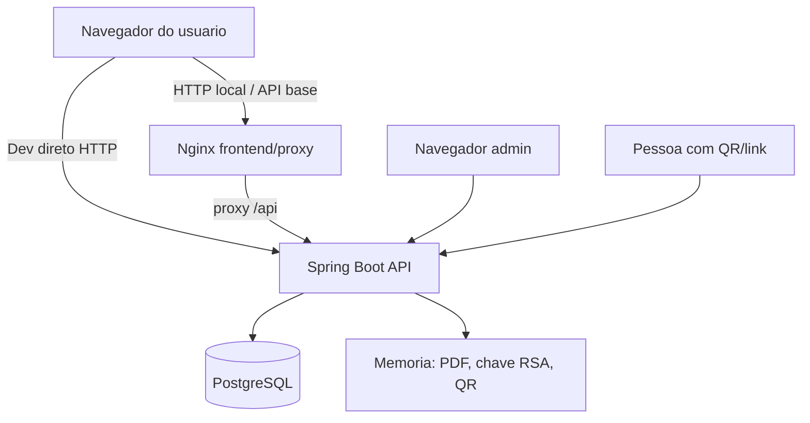

# Modelagem de ameacas e riscos

## Criterio qualitativo

Probabilidade e severidade foram classificadas como baixa, media ou alta com base em evidencia local, exposicao do endpoint, facilidade de exploracao e impacto sobre dados pessoais. Nao foi atribuida pontuacao numerica porque nao ha historico operacional, volume real de usuarios, ambiente de producao ou requisitos institucionais confirmados.

## Fronteiras de confianca

## Matriz de riscos

| ID | Ativo | Ameaca | Vulnerabilidade/evidencia | Impacto sobre dados pessoais | Probabilidade | Severidade | Controle atual | Tratamento recomendado | Teste/evidencia de validacao |
|---|---|---|---|---|---|---|---|---|---|
| R1 | PDF/JWT/senha | Interceptacao em transito | Sem TLS no repo | Vazamento de PDF, CPF, email, senha ou token | Media | Alta | Nenhum TLS observado | Configurar HTTPS/TLS | Teste `curl -vk https://...` e evidencia de certificado |
| R2 | Upload PDF | Arquivo falso ou malicioso | Valida apenas `Content-Type` | DoS, erro, processamento de conteudo nao esperado | Alta | Alta | Limite 10 MB | Validacao real/sanitizacao | Teste `.pdf` falso, MIME errado, PDF corrompido |
| R3 | Segredos | Uso de segredo versionado | `.env`, YAML e Compose contem valores dev | Acesso indevido ou JWT forjado se reutilizado | Media | Critica | Variaveis de ambiente aceitas | Rotacao e remocao segura | Secret scanning sem achados reais |
| R4 | Dados persistidos | Retencao excessiva | Sem TTL/job/politica | Exposicao prolongada de CPF, email, IP, logs | Alta | Alta | Nenhum | Politica e expurgo | Teste de job/consulta de expirados |
| R5 | Codigo verificacao | Enumeracao/tentativas | Codigo de 8 caracteres e endpoint publico | Exposicao de dados de verificacao | Media | Alta | UUID truncado; mascara CPF no GET | Token forte, rate limiting, resposta minima | Teste de brute-force bloqueado |
| R6 | Banco | Acesso indevido ao PostgreSQL/volume | Senhas dev; dados sem criptografia em repouso | Exposicao de usuarios, assinaturas e logs | Media | Alta | Rede Docker; senha | Segredos fortes e criptografia/backup seguro | Evidencia de config prod |
| R7 | Frontend | Roubo de JWT por XSS | Token e usuario em `localStorage` | Acesso como usuario/admin ate expiracao | Media | Media | Expiracao JWT | Reduzir localStorage; CSP; cookie HttpOnly se aplicavel | Teste de ausencia de token em localStorage |
| R8 | Admin CSV | Exfiltracao por admin ou conta comprometida | Exporta assinaturas/auditoria | Dados pessoais e logs em massa | Media | Alta | RBAC ADMIN | Auditoria de exportacao, minimizacao CSV, MFA | Log de exportacao e escopo reduzido |
| R9 | PDF final | Exposicao de CPF no documento | CPF completo em pagina/metadados | Compartilhamento secundario de dado pessoal | Alta | Media | Nenhum | Mascarar ou justificar inclusao | Inspecao de PDF/metadados |
| R10 | Logs/auditoria | Vazamento em detalhes | Detalhes livres; login inexistente guarda email | Dados pessoais em logs | Media | Media | Truncamento 1000 chars | Catalogo de eventos e mascaramento | Teste de ausencia de CPF/email indevido |
| R11 | Disponibilidade | DoS por CPU/memoria | PDF todo em memoria e assinatura síncrona | Indisponibilidade e falhas | Media | Alta | Limite 10 MB | Timeout, fila, limites por usuario/IP | Teste de carga controlado |
| R12 | Rotas futuras | Exposicao acidental | `anyRequest().permitAll()` | Endpoint novo publico por erro | Media | Media | Matchers especificos | Negar/autenticar por padrao | Teste endpoint desconhecido/novo |
